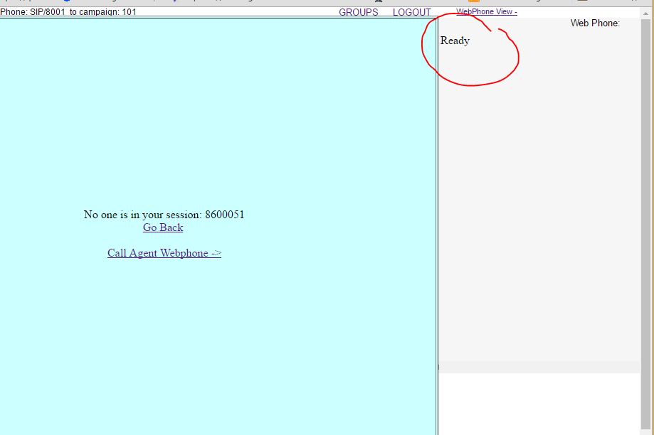

# PBXWebPhone
WebRTC based webphone for Vicidial.
Testet with ViciBox: 8.1 | VERSION: 2.14-701a | BUILD: 190302-1745  

## Getting Started
It is required that your Vicidial installation supports secure connection.

- Clone this project into agc directory (if you are using vicibox /srv/www/htdocs/agc/)
- Serve the project as static files and open `index.html`
- Configure asterisk ([Asterisk configuration example](https://github.com/chornyitaras/PBXWebPhone/wiki/Asterisk-configuration))  
- Configure apache ([Apache configuration example](https://github.com/chornyitaras/PBXWebPhone/wiki/Apache-configuration))  
- Configure Vicidial ([Vicidial configuration example](https://github.com/chornyitaras/PBXWebPhone/wiki/Vicidial-configuration))  
- Configure firewall (open port 8089)

## Static Usage
- The phone is now bootstrapped entirely in the browser from query parameters.
- Main entrypoint: `index.html`
- Local test page: `test.html`
- Existing integrations that linked to `index.php` should be updated to link to `index.html` with the same query parameters.

# Screenshot
You should see something like this when login as agent:

**PS:**  I advise to use [letsencrypt](https://letsencrypt.org/) for getting **free** ssl certificates

**PPS:**
Any comments and suggestions are welcomed. Feel free to post issue or pull request
